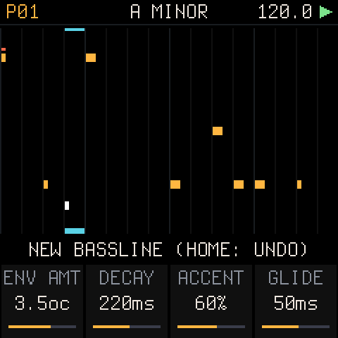
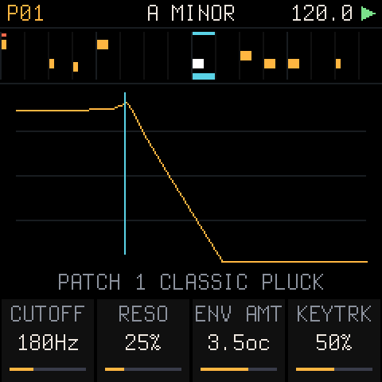
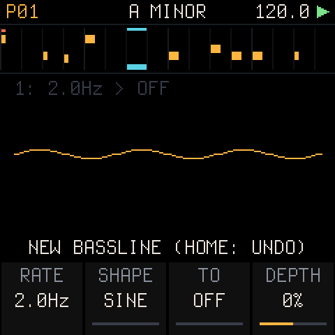

<p align="center"></p>

# Kurzhaar, der Basshund

Firmware that turns the **M-VAVE FM-1** into a monophonic analog-style bass synth with a step sequencer. It is
meant to sit next to a DAW: it follows MIDI clock tightly or runs on its own tempo, and it takes notes, program
changes and filter automation over USB.

Named for Lucca, a German Shorthaired Pointer (*Deutsch Kurzhaar*), who is on the splash screen. By JazzMasterT. Built on [Dinghy](https://github.com/zvenson/dinghy)
and [Felucca](https://github.com/hugelton/Felucca). GPL-3.0.

<p align="center">
  
  
  
</p>

## The sound

- **Oscillators:** two oscillators (saw, pulse with PWM, triangle), a square or sine sub one or two octaves down,
  and noise.
  They run at 4× the sample rate and are band-limited, so high notes and fast pitch sweeps stay clean.
- **Filter:** a nonlinear 4-pole ladder (24 or 12 dB/oct) with self-oscillation, keytracking and bass
  compensation, driven from the mixer.
- **Envelopes and modulation:** filter and amp envelopes, accent, velocity, and glide (legato or always; a slide step
  always glides). Two **LFOs** run free or synced to the bar, with six shapes and seven destinations: pitch, cutoff,
  resonance, pulse width, amp, drive and reverb.
- **Effects:** drive, saturation, "analog" drift, and a reverb that keeps the low end dry.
- **Presets:** 16 factory patches, level-matched, from Classic Pluck and Acid Line to Reese, Wobble and Deep Dub.
  There are 32 patch slots in all.

## The sequencer

- 16 patterns of up to 4 bars × 16 steps, with accent, slide, tie and gate on each step.
- Entry: step record (stopped) or live record (playing), always in the scale you choose.
- Step rate 1/4 to 1/32 including triplets, swing, and a timing offset to line up with your DAW.
- Pattern changes wait for the end of the bar.
- **Ideas (ARP):** tap for a variation of the current pattern; hold for a new bassline in the key. Hold HOME to
  undo either.

## Controls

| Control | Function |
| --- | --- |
| SELECT / ALGORITHM | Cutoff / resonance, on every page |
| PRESETS | Patch |
| KNOB1–4 | The four parameters at the bottom of the screen |
| HOME | Performance page (env amount, decay, accent, glide). Hold: undo |
| EDIT | Oscillators (press again for page 2) |
| ENV | Filter, then the filter envelope, then the amp envelope |
| LFO | LFO 1, LFO 2, LFO settings (sync, retrigger), then glide and accent |
| FX | Drive and saturation, then filter options, then reverb |
| SEL | Key and scale. Hold + a key: set the root |
| GLO | Tempo, swing, step rate; MIDI settings; ABOUT. Hold + PLAY: tap tempo |
| SEQ | White keys = steps. Hold + a white key: pattern 1–16 |
| REC / PLAY | Record / start and stop |
| SAVE | Hold: store the patch and the pattern |
| OCT− / OCT+ | Keyboard octave; in the sequencer, bar 1–4 |
| ARP | Tap: mutate the pattern. Hold: a new bassline |
| Black keys | While writing steps: ACC · SLIDE · TIE and REST · BACK |

**The manual: [docs/MANUAL.md](docs/MANUAL.md)**, every page, button and setting.

## With a DAW

Connect the FM-1 over USB. It appears as a MIDI port named **Kurzhaar FM-1**.

- **Clock:** GLO › MIDI › CLOCK set to AUTO follows the DAW's clock and its start and stop; with no clock coming in,
  Kurzhaar runs on its own tempo.
- **Where it starts:** a DAW that sends Song Position (Ableton Live, Logic, Bitwig, Reaper) can start anywhere,
  even mid-bar, and Kurzhaar picks up at the matching step. **Studio One sends no Song Position**, only Start or
  Continue, so Kurzhaar starts its pattern at step 1 when you press play: **start playback on a bar line** (grid
  snap helps) and it lines up. In Studio One's external device, tick *Send MIDI Clock*; *Use MIDI Clock Start*
  may be on or off (Kurzhaar treats both the same); *Send MIDI Timecode* is not used.
- **Notes:** play Kurzhaar from the DAW on the MIDI channel set in GLO (OMNI by default). NOTES OUT sends the
  sequencer's notes back, so you can record them.
- **Automation:** CC 74 is cutoff and CC 71 is resonance, received and/or sent (GLO › MIDI › CC).
- **Patches:** a program change (1–32) selects the patch.
- **Audio, two ways:**
  - **Over USB:** the FM-1 is also a USB audio input, **Kurzhaar FM-1**: 16-bit stereo at 44.1 or 48 kHz, at a
    fixed level: the MASTER knob sets only the speaker and headphones, so turning them down does not change a recording. Nothing to set up. With another interface as your
    DAW's audio device, combine the two in an aggregate device (macOS: Audio MIDI Setup).
  - **Analog:** the headphone output into your interface's line input.

  Either way, the GLO timing offset lines Kurzhaar up with the DAW's grid: record a few bars, measure how late
  the notes land, and turn OFFSET left by that much (− plays earlier, up to 10 ms). Measure from bar 2 on: the
  first note after Start cannot be early. In an aggregate device, tick drift correction for the FM-1, or a long
  recording slowly slides against the grid.
- **Notes from the DAW:** Kurzhaar plays each MIDI note a fixed time after it arrives (about 13 ms from the DAW
  sending it to the sound, steady to within a millisecond), so one negative **track delay** on the MIDI track lines
  them up: in Studio One with USB audio at 48 kHz, about −11 ms (−10.8 ms measured). The FM-1's own keys play at once.
- **If the FM-1 is missing as an audio input on a Mac:** close any browser tab that talks to it (the Firmware Hub,
  for one) and plug it in again. While a browser holds the FM-1, macOS cannot open its audio.

## Install

Download `kurzhaar-X.Y.fwsc` from the [releases](../../releases), then:

```sh
pip3 install mido python-rtmidi
python3 tools/fm1_install.py kurzhaar-1.1.fwsc      # over USB; asks before it writes
```

**Installing firmware is at your own risk.** To return to another firmware, or to the official one, use the
[FM-1 Firmware Hub](https://thefirmwarehub.com) in Chrome or Edge. If Kurzhaar will not start, hold **OCT−** while
switching on: the FM-1 starts in the USB rescue, where any firmware can be installed.

Kurzhaar keeps its own patches, patterns and settings (hold **SAVE**). It does not read what other firmwares saved, and
they do not read its. Another firmware may write over what Kurzhaar saved: coming back, Kurzhaar then starts from
its factory patches and patterns.

## Build

The setup is Dinghy's: Python 3, the JieLi toolchain and three files of the AC79 SDK. See
[docs/DINGHY.md](docs/DINGHY.md#2-set-up-once). Then:

```sh
./build.sh                          # -> build/kurzhaar.fwsc
./build.sh --release 1.1            # -> build/kurzhaar-1.1.fwsc
tests/run_host.sh tests/scripts/bass_tour.txt   # Kurzhaar on your computer: screens (PNG) and sound (WAV) in build/host
sh tests/run_kurzhaar_tests.sh         # the sequencer, the sound engine, the clock (needs numpy and scipy)
```

To render the patches to WAV, use `tools/render.py`. The patches themselves are plain text in `patches/`; after
editing one, run `tools/gen_patches.py`.

## License

GPL-3.0-only. Anyone who gets this firmware gets its source too. Credits and third-party parts are in
[LICENSING.md](LICENSING.md).

Kurzhaar (the app, the sound engine, the sequencer, the clock, the patches) is Copyright (C) 2026 JazzMasterT. The
platform underneath is Felucca's, by Leo Kuroshita (Hügelton Instruments), with the work of SLOOP (isod89), the
SMK-37 layer (M. Geisler) and Dinghy (zvenson). Kurzhaar is an independent project: it is not made, endorsed or
supported by Hügelton Instruments (Felucca), by Dinghy's author, or by M-VAVE. "M-VAVE" and "FM-1" belong to their
owners.

## If you enjoy this Firmware

If you download the firmware and find it useful, consider making a donation to support me at: https://buymeacoffee.com/jazzmastert
